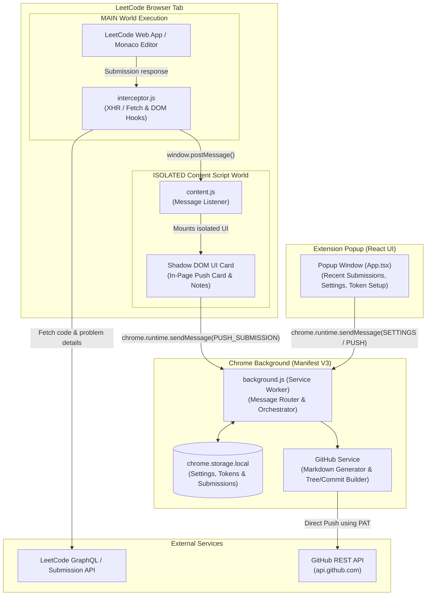

# LeetCode to GitHub Sync (Chrome Extension)

A modern, on-demand Chrome Extension (Manifest V3) that lets you push LeetCode submissions directly into your GitHub repository with zero third-party servers.

## Features

- **100% On-Demand**: Never pushes automatically unless you click the button. You stay in full control.
- **Accepted & Failed Submissions Supported**: Push working solutions or failed attempts (Wrong Answer, Time Limit Exceeded, Runtime Error) to document your debugging thought process.
- **Failures Kept Separate**: Failed attempts can be cleanly saved into an `/attempts` subfolder so your main repository solutions remain clean and organized.
- **Personal Reflection Notes**: Add custom notes / post-mortems (e.g. *"Missed edge case with empty array"*) that get committed directly to your file or markdown.
- **Automatic `README.md` Generator**: Creates detailed problem markdown with difficulty badge, performance metrics (runtime/memory beats %), and problem descriptions.
- **Resilient MAIN-World Interception**: Intercepts LeetCode's native submission checks rather than relying on brittle CSS/DOM scraping.
- **Shadow DOM UI**: In-page card on LeetCode is completely isolated from LeetCode's page styles.
- **Recent Submissions Deck**: Navigated away before pushing? Open the extension popup to push any recent submission at any time.

---

## Architecture



### Component Breakdown

1. **MAIN-World Interceptor (`interceptor.js`)**:
   - Injected directly into the LeetCode tab context.
   - Intercepts LeetCode submission check requests directly from the network layer without relying on fragile CSS selectors.
   - Fetches submission details, code (falling back to the in-memory Monaco editor if needed), and problem metadata via LeetCode's internal GraphQL endpoints.
   - Relays the payload securely to the isolated content script via `window.postMessage`.

2. **Isolated Content Script & Shadow DOM (`content.js`)**:
   - Runs in Chrome's isolated world context.
   - Listens for messages from the interceptor and notifies the user with an in-page floating submission card.
   - Encapsulated within a **Shadow DOM root** to ensure LeetCode's Tailwind/CSS stylesheets never bleed into or break the extension's UI.
   - Allows users to type reflection notes and trigger on-demand sync.

3. **Background Service Worker (`background.js`)**:
   - Central message hub handling authentication, settings persistence, and push coordination.
   - Communicates with `chrome.storage.local` to safely store user preferences, selected repositories, and submission cache.

4. **GitHub Service (`github.ts`)**:
   - Formats problem solutions, metadata comments, and generated problem `README.md` files.
   - Handles multi-file atomic Git tree and commit operations directly to the user's repository via GitHub REST API with zero intermediate servers.

5. **Popup Interface (`popup/App.tsx`)**:
   - A React + Tailwind dashboard for configuring GitHub Personal Access Tokens (PAT), selecting target repositories and branch settings.
   - Includes a **Recent Submissions Deck** allowing users to sync solutions even if they closed the LeetCode problem tab before pushing.

---

## How to Install in Chrome

1. **Build the extension** (already built in `dist/`):
   ```bash
   npm run build
   ```
2. Open Chrome and go to `chrome://extensions/`.
3. Enable **Developer mode** (toggle in the top-right corner).
4. Click **Load unpacked**.
5. Select the `dist` folder located in this project directory:
   `C:\Users\DELL\Desktop\Just for fun\dist`
6. Pin the extension to your Chrome toolbar.

---

## Setup & GitHub Authentication

1. Click on the extension icon in your Chrome toolbar.
2. Go to the **Settings** tab.
3. Paste a **GitHub Personal Access Token (PAT)**:
   - Go to [GitHub Token Settings](https://github.com/settings/tokens?type=beta) (Fine-grained) or [Classic Tokens](https://github.com/settings/tokens).
   - Grant repository permissions: `repo` (or fine-grained: `Contents: Read and write`).
4. Click **Connect**.
5. Select your target repository from the dropdown and set your preferred branch (default `main`).

---

## Development

```bash
# Watch mode for live rebuilding
npm run dev

# Production build
npm run build
```

